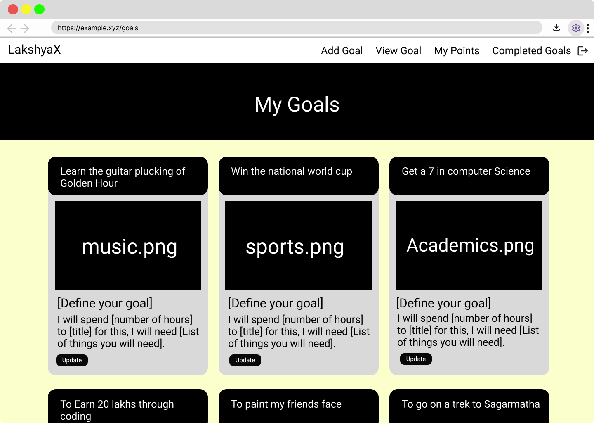

# LakshyaX

LakshyaX is a Django web app for setting personal goals and reflecting on what you learned when you finish. A goal has a deadline, a category, an importance level, and a list of what you need to get started.

[Try LakshyaX](https://lakshyax.focuskey.xyz/) · [Original designs](docs/design.md) · [Deployment architecture](docs/architecture.md)

## Try a goal

1. Choose **Get started** and create an account.
2. Add a goal such as learning a short guitar piece. Set a deadline and choose **Important**.
3. Open the goal from **View Goals**, select **Mark completed**, and write a short reflection. The completed goal keeps the reflection, and the dashboard adds 25 points.

## From sketch to app

The first designs covered the whole task, from entering a deadline to viewing the points earned. The deployed app uses a compact date picker and gives each completed goal a reflection preview with the full text available on demand.

*Original active-goals mockup. See the design archive for the form, dashboard, authentication screens, and planning diagrams.*

## Source code

- [Routes](app/main/urls.py) map URLs to the app’s views.
- [Views](app/main/views.py) handle authentication, goal updates, and completion.
- [Models](app/main/models.py) define active goals, completed goals, and points.
- [Templates](app/main/templates) and [static files](app/main/static/main) provide the interface.

The source in this repository is an earlier snapshot. The hosted app includes later interface and deployment updates, described in the linked notes.
