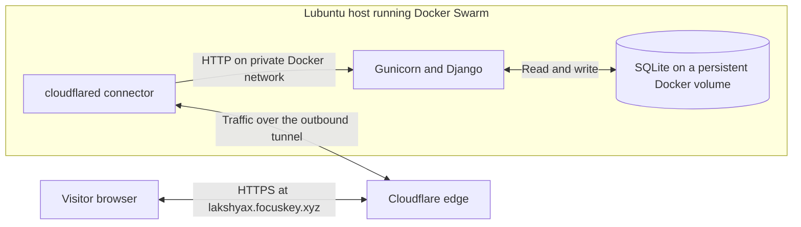
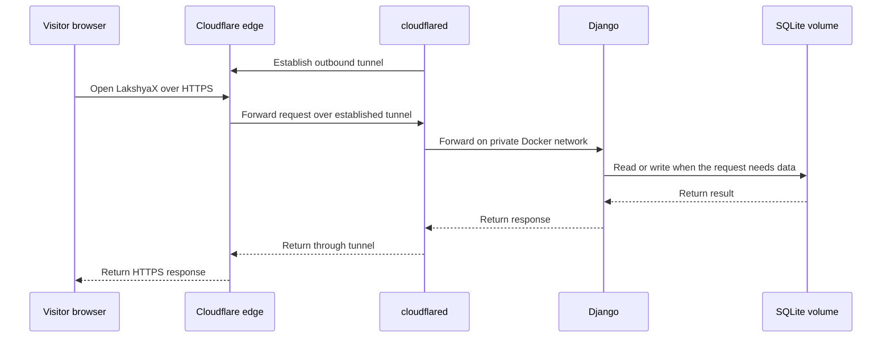

# LakshyaX deployment architecture

The public site is served by Django and Gunicorn on a Lubuntu host. Docker Swarm runs the app and the Cloudflare Tunnel connector as separate services. SQLite lives on a persistent Docker volume.

## How a request reaches the app

The browser connects to Cloudflare over HTTPS. The connector initiates the tunnel from inside the host and receives matching requests over that connection. It forwards each request to Django over the private Docker network. The public address belongs to the site, and the Swarm stack publishes zero ports on the host.

## Connection setup and request flow

The connector, app, and storage depend on one host. If that machine or its internet connection goes offline, the app becomes unavailable. The data volume persists across container replacements on that host.

[Cloudflare Tunnel fundamentals](https://developers.cloudflare.com/tunnel/concepts/) · [Back to LakshyaX](../README.md)
